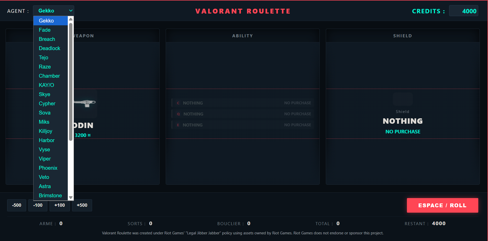
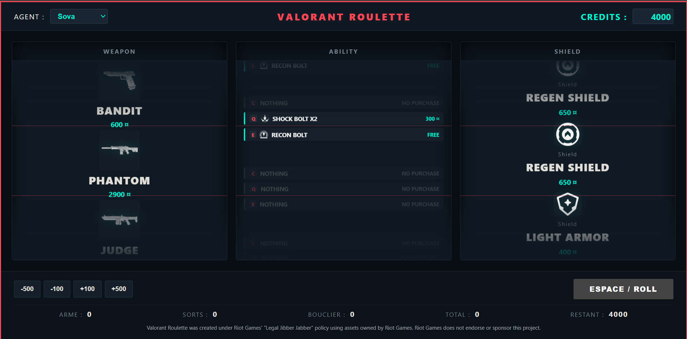

<div align="center">

# VALORANT ROULETTE

### The buy-phase roulette for your VALORANT rounds

Choose an agent, adjust your credits, and let the roulette build your loadout: weapon, abilities, and shield.


</div>

---

## About

VALORANT ROULETTE is a lightweight Electron desktop overlay designed to add an element of randomness to the buy phase. It displays three synchronized reels: **weapon**, **the selected agent's abilities**, and **shield**. The total cost and remaining credits are calculated after each spin.

## Features

- Randomly selects a weapon, abilities, and a shield.
- Maps abilities to the `C`, `Q`, and `E` keys based on the slots returned by the API.
- Tracks free starting ability charges separately from additional purchasable charges.
- Lets you enter your credit balance directly using a keyboard or numpad (from 0 to 9,000 credits).
- Quickly adjusts credits in increments of 100 or 500.
- Lets you allow or exclude individual weapons from the roulette and saves those preferences locally.
- Loads weapons, agents, names, and icons from [valorant-api.com](https://valorant-api.com/).
- Runs as a borderless, transparent, always-on-top desktop window.
- Lets you manually select your agent and enter or adjust your credits.
- Uses built-in fallback values if the API or local economy file is unavailable.

## Screenshots





## Controls

| Key / control | Action |
| --- | --- |
| `Space` | Spin the roulette if no spin is already in progress |
| `Ctrl` + `Shift` + `X` | Show or hide the overlay |
| `CREDITS` field | Enter a whole-number balance from 0 to 9,000 using a keyboard or numpad |
| `-500` button | Subtract 500 credits |
| `-100` button | Subtract 100 credits |
| `+100` button | Add 100 credits |
| `+500` button | Add 500 credits |
| `ARMES` button | Choose which weapons can appear in the roulette; preferences are saved locally |

The global hotkey is registered by Electron. The credits field is disabled during a spin so the balance used by the roulette stays fixed until the animation ends.

## Data sources

The app makes requests to the following public endpoints:

- `https://valorant-api.com/v1/weapons` for weapons and their icons.
- `https://valorant-api.com/v1/gear` for gear and shields.
- `https://valorant-api.com/v1/agents?isPlayableCharacter=true` for agents, abilities, descriptions, and icons.

The agents API does not provide the purchase costs and charge counts required by the roulette, so these are supplied locally. The optional `abilities_economy.json` file, placed next to `in_game.html`, lets you define these values by agent name and API slot. Any missing entries use the built-in values in `in_game.js`.

Example structure:

```json
{
  "Phoenix": {
    "Ability2": { "key": "E", "cost": 250, "freeCharges": 1, "maxPurchases": 1 }
  },
  "Gekko": {
    "Ability2": { "key": "E", "cost": 0, "freeCharges": 1, "maxPurchases": 0 }
  }
}
```

`freeCharges` is the number of charges available at the start of the round. `maxPurchases` is the number of additional charges that can be bought, and `cost` is charged for each purchased charge. Existing configurations using `maxCharges` remain supported; that legacy value is treated as the total charge limit, including free charges.

The API slots `Ability1`, `Ability2`, and `Grenade` correspond to the abilities assigned to the `Q`, `E`, and `C` keys by default. The JSON `key` field lets you configure which key is displayed in the roulette.

## Technologies

- **Electron**: desktop window, global hotkey, and application lifecycle.
- **HTML5**: interface structure.
- **CSS3**: styling and reel animations.
- **JavaScript (ES6+)**: spin logic, credit calculations, and data merging.
- **Fetch API**: HTTP requests to the VALORANT API.
- **JSON**: local ability economy data.

No build step is required. Install dependencies with `npm install`, then launch the app with `npm start`. Use the overlay with VALORANT in borderless windowed mode.

## Main files

| File | Purpose |
| --- | --- |
| `main.js` | Electron window, global hotkey, and application lifecycle |
| `preload.js` | Restricted renderer-to-main IPC bridge |
| `in_game.html` | Roulette interface |
| `in_game.js` | API requests, data merging, and game logic |
| `package.json` | Electron entry point and start script |
| `abilities_economy.json` | Optional local settings for ability costs, keys, and charges |

## Legacy files

The `legacy/overwolf/` directory contains files from the old Overwolf app. They are no longer used by the Electron app and can be removed as a group.

## Getting started

1. Run `npm install` to install dependencies.
2. Run `npm start` to open the overlay.
3. Start VALORANT in borderless windowed mode, then toggle the overlay with `Ctrl` + `Shift` + `X`.
4. Select an agent, enter or adjust your credits, then spin with `Space`.


## Comment le distribuer à tes amis sous forme de .exe

Tes potes n'auront pas besoin d'installer Node.js ou de taper des commandes. Tu peux compiler le tout en un exécutable autonome en une seule commande :

1. Installe l'outil de packaging :
```bash
npm install --save-dev electron-packager
```

2. Génère le fichier .exe pour Windows :
```bash
npx electron-packager . ValorantRoulette --platform=win32 --arch=x64 --out=dist/ --overwrite
```

3. Rends toi dans le dossier dist/ValorantRoulette-win32-x64 qui vient d'être créé :

Compresse-le en fichier .zip et envoie-le à tes potes. Il leur suffira de double-cliquer sur ValorantRoulette.exe